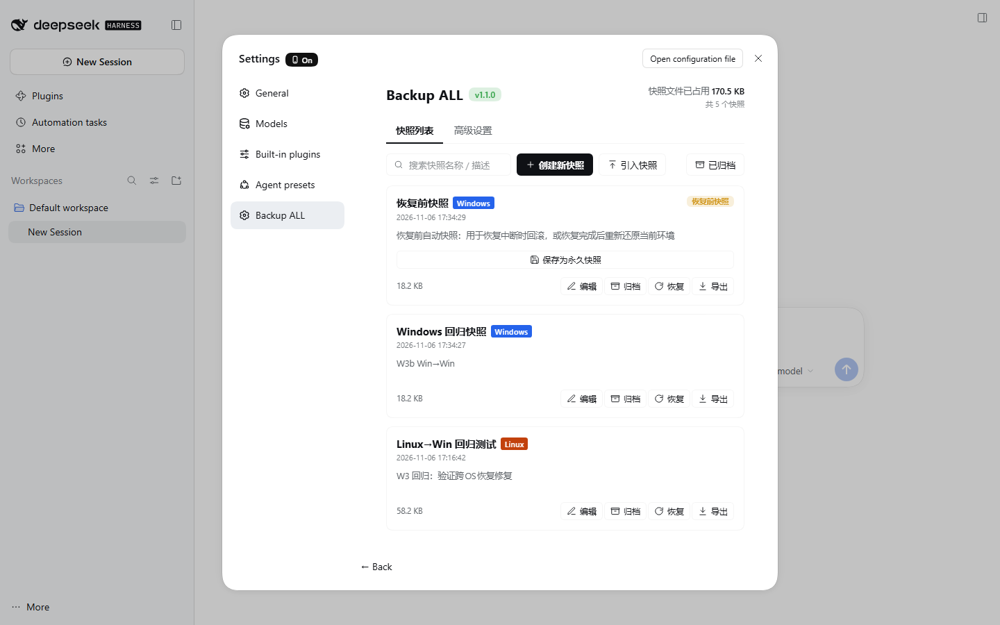
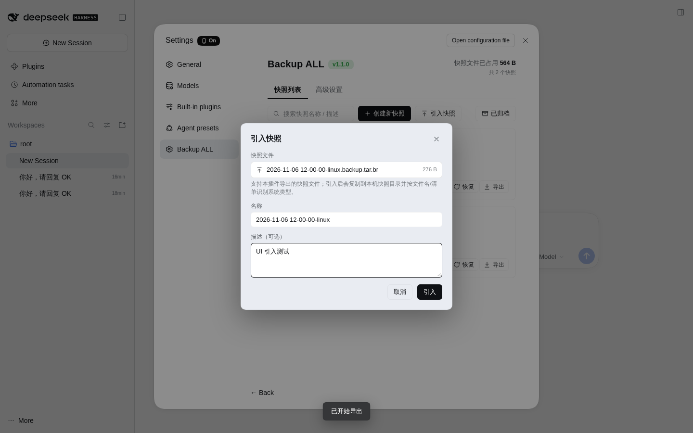

# dsh-backup-all

> An all-in-one snapshot & restore plugin for **DSH (DeepSeek Harness)**: archive your installed plugins, Skills, MCP servers, Agent Presets, config, credentials and external data into one high-compression snapshot, then let AI compare and restore the whole environment.

[简体中文](README.md) | **English**

[](CHANGELOG.md)
[](https://github.com/deepseek-ai)
[](https://nodejs.org)
[](LICENSE)

---

## Why

A long-lived DSH environment is scattered across many places: profile config, plugins in `node_modules`, local plugins under `dshbox-plugins`, Skills, MCP connections, Agent Presets, `.credentials.yaml`, external working directories… Manual backup is nearly impossible to get complete, and migration between machines or operating systems is error-prone.

**dsh-backup-all turns the whole environment into a restorable snapshot**:

- **Create**: the Host collects fixed configs, credentials and Skills; AI discovers external data that is actually referenced by the running environment and writes a restore plan plus `RESTORE.md`.
- **Restore**: AI compares the snapshot with the current environment, applies files in batches (with safety backups), then reinstalls dependencies.
- **Cross-OS**: Linux ↔ Windows compatible restore (config/data/credentials migrate; plugin code follows a policy).

## Features

- **High-compression snapshots**: tar + Brotli (quality 11), typically ~10% of the original size.
- **AI-driven**: a separately configured model (OpenAI-compatible or Anthropic) performs snapshot/restore through visible tool calls; runs are interruptible.
- **Safety nets**: a pre-restore snapshot is created automatically; every overwritten file is backed up first.
- **Cross-platform**: snapshot filenames carry the OS type (`...-linux.backup.tar.br` / `...-windows.backup.tar.br`); four scenarios:
  - Linux → Linux / Windows → Windows: full restore;
  - Linux → Windows / Windows → Linux: compatible restore (symlinks skipped, registry plugins reinstalled from source, external paths fall back, old-machine absolute `link:` deps removed).
- **Optional pure-JS plugin-code migration** (v1.3.0, experimental): locally undownloadable plugins may be migrated across OSes when they are proven pure JS; plugins with native binaries/platform constraints are skipped with a clear reason.
- **Import / export snapshots** from the UI.
- **Polished UI**: a dedicated "Backup ALL" settings section, Windows-blue / Linux-orange / legacy-gray OS badges, floating progress ball, mobile layout.

<table>
<tr>
<td></td>
<td></td>
</tr>
<tr>
<td align="center">Snapshot list · OS badges · per-card export</td>
<td align="center">Import snapshot · filename-derived default name</td>
</tr>
</table>

## Install

Requirements: DSH `0.2.1-rc.5` (or compatible), Node.js >= 22, pnpm (provided by DSH plugin management).

### From GitHub (recommended)

```bash
dsh plugin --profile web add github:luotianhao21/dsh-backup-all
```

Restart DSH, check **Settings → Plugins** that `dsh-backup-all` is enabled; a **Backup ALL** section appears in Settings.

### From a local checkout

```bash
git clone https://github.com/luotianhao21/dsh-backup-all.git
cd dsh-backup-all
dsh plugin --profile web add link:"$PWD"
```

### From a release archive

Download a source archive from [Releases](https://github.com/luotianhao21/dsh-backup-all/releases), extract it, then install it with `link:` as above.

## Quick start

1. **Settings → Backup ALL → Advanced**, configure the AI model (Base URL / API Key / Model ID, OpenAI-compatible or Anthropic), then click "Test connection".
2. (Optional) choose the snapshot policy: plugin-code packing scope, whether to exclude credentials, and the cross-OS plugin-code strategy.
3. On the **Snapshots** page click **Create snapshot**, confirm the two-step dialog, and wait for the run to finish.
4. To restore, click **Restore** on a snapshot card; a pre-restore snapshot is created automatically.
5. Moving machines? Copy the `.backup.tar.br` file and use **Import snapshot**.

### Snapshot policy

| Setting | Default | Description |
|---|---|---|
| Plugin code | local-only | `local-only` / `all` / `none` |
| Exclude credentials | off | When on, `.credentials.yaml` is not packed |
| Cross-OS plugin code | skip | `skip` / `js` (experimental pure-JS migration) |

### Cross-OS compatibility matrix

| Snapshot OS → current OS | Strategy | Behavior |
|---|---|---|
| Linux → Linux | Full restore | All entries + dependency reinstall |
| Windows → Windows | Full restore (Windows semantics) | junction/symlink fallback, ACL, PowerShell/cmd |
| Linux → Windows | Compatible restore | Config/data/credentials; plugin code skipped by default; symlinks skipped; registry plugins reinstalled; external paths fall back |
| Windows → Linux | Compatible restore | Symmetric to the above |

> Cross-OS restore is **compatible restore**, not a byte-for-byte mirror. Native plugins, system services and registry-related content must be rebuilt on the target OS. With "migrate pure JS plugin code" enabled, the Host only writes plugin-code directories that pass a conservative pure-JS check (no `.node/.dll/.exe`, `package.json` `os`/`cpu` match, no `gypfile`, size/file limits); everything else is skipped and listed in the summary.

## Security

- Snapshots may contain plaintext credentials (`.credentials.yaml`); treat snapshot files as sensitive and never publish them.
- Overwritten files are backed up before writing; a pre-restore snapshot is created automatically.
- AI prompts contain environment summaries, not plaintext credentials.
- Rotate API keys and other secrets after restoring/migrating.

## Project layout

```
dsh-backup-all/
├── index.js            # Host plugin entry
├── client.js           # Web client (settings page / floating ball / dialogs)
├── cordis.patch.yml    # DSH bundle patch
├── lib/                # Host logic (archive / runner / tools / prompts / platform)
├── prompts/            # Generic AI system prompts
├── locale/             # zh-CN / en-US strings
├── test/               # Node test suite (81 tests)
└── docs/               # API contract / platform strategies / UI spec
```

## Development

```bash
node --check client.js
for f in lib/*.js; do node --check "$f"; done
node --test test/*.test.mjs     # 81 tests
```

## Docs

- [API contract](docs/API-CONTRACT.md)
- [Platform strategies](docs/PLATFORM-STRATEGIES.md)
- [UI spec](docs/UI-SPEC.md)
- [Changelog](CHANGELOG.md)

## License

[MIT](LICENSE) © 2026 luotianhao21

> Independently developed; not affiliated with DeepSeek. Evaluate snapshot/credential security risks before use.
