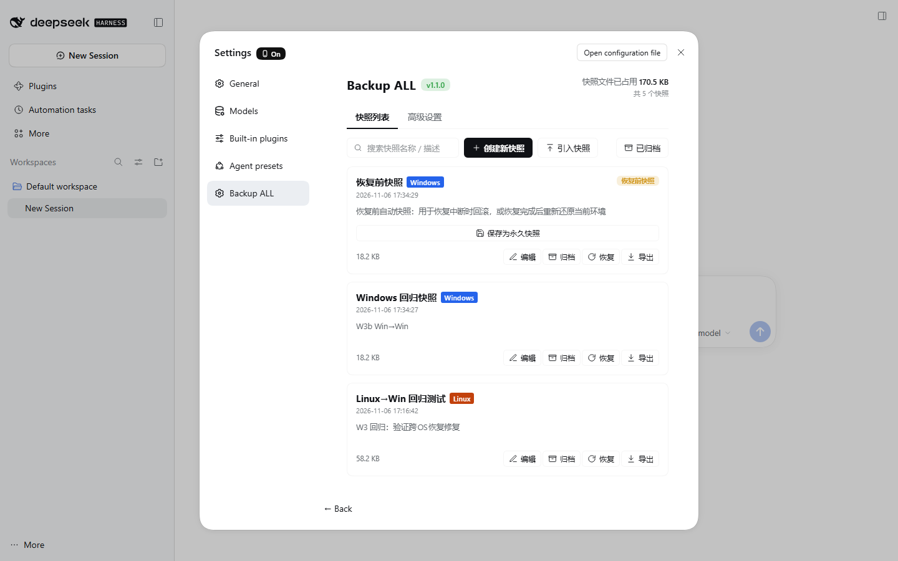
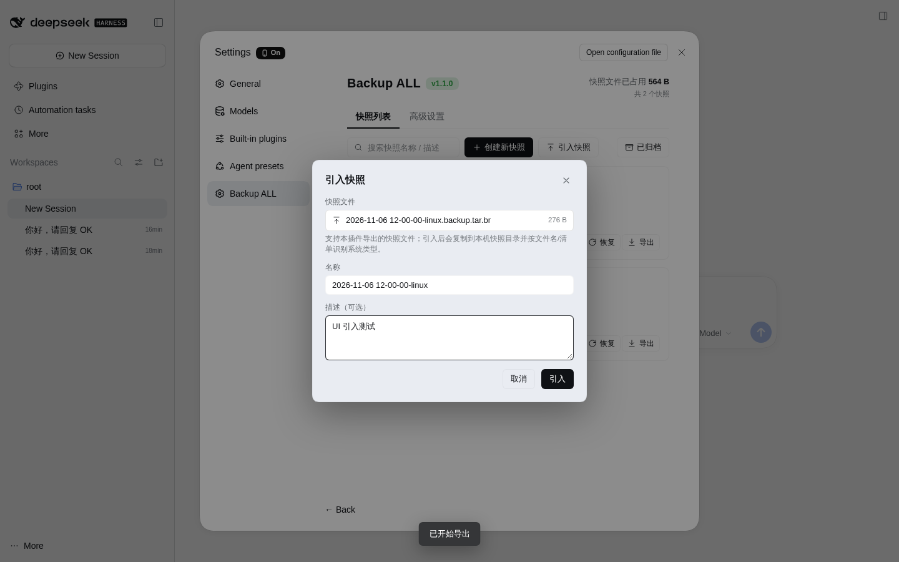

# dsh-backup-all

> 给 DSH（DeepSeek Harness）做「整环境快照 / 恢复」的插件：把已安装的插件、Skill、MCP、Agent Preset、配置、凭据与外部数据打包成高压缩快照，恢复时由 AI 按快照清单自动比对、写回并重装依赖。

**简体中文** | [English](README.en.md)

[](CHANGELOG.md)
[](https://github.com/deepseek-ai)
[](https://nodejs.org)
[](LICENSE)

---

## 它解决什么问题

DSH 装久了，环境会散落在很多地方：profile 配置、`node_modules` 里的插件、`dshbox-plugins` 本地插件、Skill、MCP 连接、Agent Preset、`.credentials.yaml`、外部工作目录……手工备份几乎不可能完整，换机器 / 迁移系统时更容易丢东西。

**dsh-backup-all 把「整个环境」变成一个可回滚的快照文件**：

- 创建快照：Host 自动收集固定配置、凭据、Skill 等；AI 负责发现「插件之外、但运行时确实被引用」的外部数据，并写恢复计划与 `RESTORE.md`；
- 恢复环境：AI 先 `compare` 出差异，再分批写回（写前有安全备份），最后重装依赖；
- 跨操作系统：Linux ↔ Windows 之间做**兼容恢复**（配置/数据/凭据迁移，插件代码按策略处理）。

## 功能一览

- **高压缩快照**：tar + Brotli（质量 11），体积通常只有原文件的 10% 左右；自带 `manifest.json` / `INVENTORY.md` / `RESTORE.md`。
- **AI 驱动**：快照与恢复都走一个可独立配置的模型（OpenAI 兼容 / Anthropic），工具调用全程可见、可中断。
- **完整恢复 + 安全网**：恢复前自动创建「恢复前快照」；写回前逐文件做安全备份；失败/中断可回滚。
- **跨平台**：快照文件名带系统类型（`...-linux.backup.tar.br` / `...-windows.backup.tar.br`），manifest 记录 OS；四场景：
  - Linux → Linux、Windows → Windows：完整恢复；
  - Linux → Windows、Windows → Linux：兼容恢复（跳过符号链接、registry 插件按来源重装、外部路径 fallback、profile 里旧机绝对 `link:` 依赖清理）。
- **可选：跨 OS 迁移纯 JS 插件代码**（v1.3.0，实验性）：本地不可再下载的插件，如果确认是纯 JS，可以跟着快照迁到目标系统；含原生二进制/平台限制的插件仍跳过并写明原因。
- **引入 / 导出快照**：任何 `.backup.tar.br` 都能通过 UI「引入快照」导入，也能把任意卡片导出下载。
- **UI 友好**：设置窗口新增「Backup ALL」页（列表 / 已归档 / 高级设置）；Windows 蓝 / Linux 橙 / 旧版灰的系统徽章；后台运行时贴边悬浮进度球；移动端适配。

<table>
<tr>
<td></td>
<td></td>
</tr>
<tr>
<td align="center">快照列表 · Windows / Linux 系统徽章 · 每卡导出</td>
<td align="center">引入快照 · 默认名称自动去后缀</td>
</tr>
</table>

## 安装

前置：DSH `0.2.1-rc.5`（或兼容版本）、Node.js >= 22、pnpm（DSH 自带插件管理）。

### 方式一：从 GitHub 安装（推荐）

```bash
dsh plugin --profile web add github:luotianhao21/dsh-backup-all
```

装完后重启 DSH，打开 **设置 → 插件** 确认 `dsh-backup-all` 已启用，设置侧栏会出现 **Backup ALL**。

### 方式二：从本地源码安装

```bash
git clone https://github.com/luotianhao21/dsh-backup-all.git
cd dsh-backup-all
dsh plugin --profile web add link:"$PWD"
```

> 从源码 `link:` 安装后，Host 代码改动需要重启 DSH；`client.js` 的 UI 改动会热更新。

### 方式三：离线包

在 [Releases](https://github.com/luotianhao21/dsh-backup-all/releases) 下载源码压缩包解压后，按「方式二」用 `link:` 安装。

## 快速开始

1. 打开 **设置 → Backup ALL → 高级设置**，填写 AI 模型（Base URL / API Key / Model ID，支持 OpenAI 兼容与 Anthropic 协议），点「测试模型接通性」。
2. （可选）在「快照策略」里选择插件代码打包范围、是否不打包凭据，以及跨 OS 恢复时的插件代码策略。
3. 回到「快照」页，点「创建新快照」，两步确认后开始；后台可看进度，完成后生成一条快照记录。
4. 需要恢复时，点快照卡片的「恢复」；恢复前会自动创建「恢复前快照」。
5. 换机器时，把 `.backup.tar.br` 拷过去，用「引入快照」导入即可。

### 快照策略

| 设置 | 默认 | 说明 |
|---|---|---|
| 插件代码本体 | 仅打包本地不可再下载插件 | `local-only` / `all` / `none` |
| 不打包凭据 | 关 | 开启后 `.credentials.yaml` 不入包，恢复后需重填 |
| 跨 OS 恢复插件代码 | 跳过 | `skip` / `js`（尝试迁移纯 JS 插件代码，实验性） |

### 跨 OS 兼容性矩阵

| 快照 OS → 当前 OS | 策略 | 行为 |
|---|---|---|
| Linux → Linux | 完整恢复 | 全部条目 + 依赖重装 |
| Windows → Windows | 完整恢复（Windows 语义） | junction/symlink 降级复制、ACL、PowerShell/cmd |
| Linux → Windows | 兼容恢复 | 配置/数据/凭据写回；插件代码默认跳过；符号链接跳过；registry 插件重装；外部路径 fallback |
| Windows → Linux | 兼容恢复 | 同上，反向对称 |

> 跨 OS 是**兼容恢复**，不是逐字节镜像：原生插件/系统服务/注册表相关内容需要在目标系统重建。选择「尝试迁移纯 JS 插件代码」后，Host 只会写回通过纯 JS 校验的插件代码（无 `.node/.dll/.exe`、`package.json` 的 `os/cpu` 匹配、非 `gypfile`、体积/文件数在限制内）；其余仍跳过并在摘要中列出。

## 安全说明

- 快照可能包含 `.credentials.yaml` **明文凭据**（可在策略里关闭），请把快照文件当作敏感数据保存，不要提交到公开仓库或随意外发。
- 恢复写回前会对被覆盖文件做安全备份；恢复前还会自动创建「恢复前快照」。
- AI 请求只包含环境摘要与必要条目信息，Host 不会把凭据明文放进 prompt。
- 建议恢复/迁移完成后轮换 API Key 等凭据。

## 目录结构

```
dsh-backup-all/
├── index.js            # Host 插件入口（挂载路由、工具、UI 槽）
├── client.js           # Web 客户端（设置页 / 悬浮球 / 弹窗，纯 JS 无构建）
├── cordis.patch.yml    # DSH bundle patch
├── lib/                # Host 逻辑（archive / runner / tools / prompts / 平台适配）
├── prompts/            # AI 系统提示词（泛型，不绑定具体插件）
├── locale/             # 中英文文案
├── test/               # Node 原生测试（81 项）
└── docs/               # API 契约 / 跨平台策略 / UI 规格
```

## 开发与测试

```bash
node --check client.js
for f in lib/*.js; do node --check "$f"; done
node --test test/*.test.mjs     # 81 tests
```

测试覆盖：归档解包/权限/符号链接、路径安全与重映射、跨 OS 兼容矩阵、导入导出路由、UI 状态机、Host 端到端（mock AI）等。

## 文档

- [API 契约](docs/API-CONTRACT.md)
- [跨平台策略](docs/PLATFORM-STRATEGIES.md)
- [UI 规格](docs/UI-SPEC.md)
- [更新日志](CHANGELOG.md)

## License

[MIT](LICENSE) © 2026 luotianhao21

> 本插件由个人开发维护，与 DeepSeek 官方无隶属关系；使用前请自行评估快照与凭据的安全风险。
